<div align="center">

<h1>paper-generator</h1>

<p><strong>A Claude Code plugin that takes a research idea to a submitted paper, past 3 simulated reviewers.</strong></p>

[](https://github.com/zyx1121/paper-generator/actions)
[](.claude-plugin/plugin.json)
[](https://docs.anthropic.com/en/docs/claude-code/plugins)
[](LICENSE)

**English** | [繁體中文](README.zh-TW.md) | [简体中文](README.zh-CN.md)

```mermaid
flowchart LR
    idea([idea]) --> ideation
    ideation -->|"G1 proposal"| setup
    setup -->|"G2 venue, plan"| implementation
    implementation -->|"G3 artifact"| experiments
    experiments -->|"G4 results"| analysis
    analysis --> writing
    writing -->|"G5 draft"| review["review loop"]
    review -->|"G6 all accept"| finalize
    finalize -->|submit| publication
    publication -->|"G7 camera-ready"| pdf([doi])
    review -.->|"must-fix: back to any stage"| implementation
    publication -.->|"reject: harvest, new venue"| review
```

</div>



A paper from start to end needs many roles: the idea, the experiments, the LaTeX and a hard reviewer. This plugin plays all of them, but it does not skip the important part. Each number in the draft must come from a real experiment run, and each draft must pass a simulated program committee. It writes and reviews in the style of the target venue.

## Features

- **9 stages with gates**: the pipeline stops at 7 gates (G1 to G7) for your decision, with a recommendation. Between gates, it runs alone.
- **No invented data**: each number traces to a run in `paper/experiments/`, with its command, config, seed, environment and commit.
- **Venue styles**: 7 field profiles (systems, networking, ML, security, SE, HCI, journals) set the structure, the evaluation and the reviewer bar.
- **Simulated reviewers**: 3 reviewer personas for each venue. The loop continues until all 3 accept.
- **Resumes**: the state is in `paper/STATE.md`, so a later session continues where you stopped.

## Quick start

```
/plugin marketplace add zyx1121/paper-generator
/plugin install paper-generator@paper-generator
```

Then start a paper and talk it through:

```
/paper-generator:paper a gossip protocol that heals partitions without a coordinator
```

Run `/paper-generator:paper` with no idea to continue the paper in `paper/`.

## Usage

Each stage is also a skill with the `paper-generator:` prefix: `ideation`, `setup`, `implementation`, `experiments`, `analysis`, `writing`, `review`, `finalize` and `publication`. Use `review` to mock-review any draft, and `publication` for the rebuttal, the revision and the camera-ready copy.

| Part | Does |
|------|------|
| `skills/paper` | Runs the 9 stages, the gates and the `paper/STATE.md` protocol |
| `skills/writing/references/venues/` | The 7 venue profiles. Each format fact has a `Facts verified:` date and gets a new check against the live CFP |
| `skills/writing/references/` | The style rules, a phrasebook from award papers, and the TikZ figure workflow |
| `agents/reviewer` | A simulated reviewer with 3 personas for each venue profile |
| `agents/copyeditor` | Edits prose for style and venue tone, and keeps the technical content |
| `mcp/paper_tools.py` | MCP tools: `latex_compile`, `render_figure`, `arxiv_search`, `scholar_search`, `dblp_bibtex`, `fetch_paper`, `trace_check`, `style_lint` |

## Configuration

| Needs | For | Without it |
|-------|-----|------------|
| Python 3.9 or later as `python3` | the bundled MCP server | the tools do not start |
| `latexmk` (TeX Live) or `tectonic` | PDF builds | the pipeline tells you what is missing |
| `matplotlib` | figure scripts | no figures |
| `S2_API_KEY` from [Semantic Scholar](https://www.semanticscholar.org/product/api) | better `scholar_search` data | results come from OpenAlex |

## Limits

- The pipeline cannot make evidence that needs people, such as user studies or vendor disclosure. It declares that evidence at the gate.
- `trace_check` and `style_lint` only flag problems. They do not fix them.

## For AI agents

Facts for coding agents and LLM tools. The rules for changing the code are in [AGENTS.md](AGENTS.md).

- **Summary**: Claude Code plugin with a 9-stage idea-to-paper pipeline, 7 gates, venue-specific style profiles, simulated reviewers and a stdlib MCP server.
- **Type**: plugin
- **Interfaces**: skills `paper-generator:<stage>`, agents `reviewer` and `copyeditor`, 8 MCP tools from `mcp/paper_tools.py`, state file `paper/STATE.md`
- **Install**: `/plugin marketplace add zyx1121/paper-generator`, then `/plugin install paper-generator@paper-generator`
- **Run**: `/paper-generator:paper <idea>`
- **Verify**: `python3 scripts/ci_checks.py`
- **Config**: env `S2_API_KEY` (optional)
- **Secrets**: `S2_API_KEY` (optional)
- **Limits**: needs Python 3.9 or later and `latexmk` or `tectonic`

## Development

```sh
python3 scripts/ci_checks.py   # links, cross-references, manifest, frontmatter, Python syntax, MCP self-tests
```

CI runs the same script with no installs. The MCP server uses the standard library only.

## License

[MIT](LICENSE)
