<!-- 翻译自 README.md @ docs/readme-template-v2。只翻 "For AI agents" 以上的章节，英文版更新时一起改。 -->

<div align="center">

<h1>paper-generator</h1>

<p><strong>把研究想法变成投稿论文的 Claude Code plugin，途中要过 3 位模拟审稿人。</strong></p>

[](https://github.com/zyx1121/paper-generator/actions)
[](.claude-plugin/plugin.json)
[](https://docs.anthropic.com/en/docs/claude-code/plugins)
[](LICENSE)

[English](README.md) | [繁體中文](README.zh-TW.md) | **简体中文**

```mermaid
flowchart LR
    idea([idea]) --> ideation
    ideation -->|"G1 proposal"| setup
    setup -->|"G2 venue, plan"| implementation
    implementation -->|"G3 artifact"| experiments
    experiments -->|"G4 results"| analysis
    analysis --> writing
    writing -->|"G5 draft"| review["review loop"]
    review -->|"G6 all accept"| finalize
    finalize -->|submit| publication
    publication -->|"G7 camera-ready"| pdf([doi])
    review -.->|"must-fix: back to any stage"| implementation
    publication -.->|"reject: harvest, new venue"| review
```

</div>



从头到尾写一篇论文需要很多角色：想点子、跑实验、排 LaTeX，还要当严格的审稿人。这个 plugin 全包，但不跳过最重要的部分。草稿里每个数字都必须来自真实的实验运行，每份草稿都必须通过模拟的程序委员会。它按目标会议的风格写作与审稿。

## 功能

- **9 个阶段与关卡**：流程在 7 个关卡(G1 到 G7)停下来等你决定，并附上建议。关卡之间自动执行。
- **不捏造数据**：每个数字都能追溯到 `paper/experiments/` 里的一次运行，含命令、配置、seed、环境与 commit。
- **会议风格**：7 个领域配置文件(systems、networking、ML、security、SE、HCI、期刊)决定结构、实验呈现与审稿标准。
- **模拟审稿人**：每个会议 3 位审稿人 persona。审稿循环持续到 3 位都接受。
- **可接续**：状态存在 `paper/STATE.md`，之后的 session 从你停下的地方继续。

## 快速开始

```
/plugin marketplace add zyx1121/paper-generator
/plugin install paper-generator@paper-generator
```

接着开始一篇论文，边聊边推进：

```
/paper-generator:paper a gossip protocol that heals partitions without a coordinator
```

不带想法运行 `/paper-generator:paper`，就会接续 `paper/` 里的论文。

## 使用方式

每个阶段也是一个 `paper-generator:` 开头的 skill：`ideation`、`setup`、`implementation`、`experiments`、`analysis`、`writing`、`review`、`finalize` 与 `publication`。`review` 可以模拟审任何草稿，`publication` 处理 rebuttal、修订与 camera-ready。

| 部分 | 作用 |
|------|------|
| `skills/paper` | 执行 9 个阶段、关卡与 `paper/STATE.md` 协议 |
| `skills/writing/references/venues/` | 7 个会议配置文件。每个格式事实都有 `Facts verified:` 日期，并会对照最新 CFP 重新检查 |
| `skills/writing/references/` | 文风规则、取自获奖论文的句型集，以及 TikZ 图表流程 |
| `agents/reviewer` | 模拟审稿人，每个会议配置文件 3 种 persona |
| `agents/copyeditor` | 按文风与会议语气润色，不动技术内容 |
| `mcp/paper_tools.py` | MCP 工具：`latex_compile`、`render_figure`、`arxiv_search`、`scholar_search`、`dblp_bibtex`、`fetch_paper`、`trace_check`、`style_lint` |

## 配置

| 需要 | 用途 | 没有时 |
|------|------|--------|
| Python 3.9 以上(`python3`) | 内置的 MCP server | 工具无法启动 |
| `latexmk`(TeX Live)或 `tectonic` | 编译 PDF | 流程会告诉你缺什么 |
| `matplotlib` | 图表脚本 | 没有图表 |
| [Semantic Scholar](https://www.semanticscholar.org/product/api) 的 `S2_API_KEY` | 更完整的 `scholar_search` 数据 | 改用 OpenAlex 的结果 |

## 限制

- 需要真人的证据(例如用户研究或厂商披露)流程无法产生，会在关卡上声明。
- `trace_check` 与 `style_lint` 只标出问题，不会修正。

## 其他

给 AI agent 的结构化信息与开发说明在[英文版](README.md#for-ai-agents)。

## 许可证

[MIT](LICENSE)
