<!-- 翻譯自 README.md @ docs/readme-template-v2。只翻 "For AI agents" 以上的章節，英文版更新時一起改。 -->

<div align="center">

<h1>paper-generator</h1>

<p><strong>把研究點子變成投稿論文的 Claude Code plugin，途中要過 3 位模擬審稿人。</strong></p>

[](https://github.com/zyx1121/paper-generator/actions)
[](.claude-plugin/plugin.json)
[](https://docs.anthropic.com/en/docs/claude-code/plugins)
[](LICENSE)

[English](README.md) | **繁體中文** | [简体中文](README.zh-CN.md)

```mermaid
flowchart LR
    idea([idea]) --> ideation
    ideation -->|"G1 proposal"| setup
    setup -->|"G2 venue, plan"| implementation
    implementation -->|"G3 artifact"| experiments
    experiments -->|"G4 results"| analysis
    analysis --> writing
    writing -->|"G5 draft"| review["review loop"]
    review -->|"G6 all accept"| finalize
    finalize -->|submit| publication
    publication -->|"G7 camera-ready"| pdf([doi])
    review -.->|"must-fix: back to any stage"| implementation
    publication -.->|"reject: harvest, new venue"| review
```

</div>



從頭到尾寫一篇論文需要很多角色：想點子、跑實驗、排 LaTeX，還要當嚴格的審稿人。這個 plugin 全包，但不跳過最重要的部分。草稿裡每個數字都必須來自真實的實驗執行，每份草稿都必須通過模擬的程式委員會。它依目標會議的風格寫作與審稿。

## 功能

- **9 個階段與關卡**：流程在 7 個關卡(G1 到 G7)停下來等你決定，並附上建議。關卡之間自動執行。
- **不捏造資料**：每個數字都能追溯到 `paper/experiments/` 裡的一次執行，含指令、設定、seed、環境與 commit。
- **會議風格**：7 個領域設定檔(systems、networking、ML、security、SE、HCI、期刊)決定結構、實驗呈現與審稿標準。
- **模擬審稿人**：每個會議 3 位審稿人 persona。審稿迴圈持續到 3 位都接受。
- **可接續**：狀態存在 `paper/STATE.md`，之後的 session 從你停下的地方繼續。

## 快速開始

```
/plugin marketplace add zyx1121/paper-generator
/plugin install paper-generator@paper-generator
```

接著開始一篇論文，邊聊邊推進：

```
/paper-generator:paper a gossip protocol that heals partitions without a coordinator
```

不帶點子執行 `/paper-generator:paper`，就會接續 `paper/` 裡的論文。

## 使用方式

每個階段也是一個 `paper-generator:` 開頭的 skill：`ideation`、`setup`、`implementation`、`experiments`、`analysis`、`writing`、`review`、`finalize` 與 `publication`。`review` 可以模擬審任何草稿，`publication` 處理 rebuttal、修訂與 camera-ready。

| 部分 | 作用 |
|------|------|
| `skills/paper` | 執行 9 個階段、關卡與 `paper/STATE.md` 協定 |
| `skills/writing/references/venues/` | 7 個會議設定檔。每個格式事實都有 `Facts verified:` 日期，並會對照最新 CFP 重新檢查 |
| `skills/writing/references/` | 文風規則、取自得獎論文的句型集，以及 TikZ 圖表流程 |
| `agents/reviewer` | 模擬審稿人，每個會議設定檔 3 種 persona |
| `agents/copyeditor` | 依文風與會議語氣潤稿，不動技術內容 |
| `mcp/paper_tools.py` | MCP 工具：`latex_compile`、`render_figure`、`arxiv_search`、`scholar_search`、`dblp_bibtex`、`fetch_paper`、`trace_check`、`style_lint` |

## 設定

| 需要 | 用途 | 沒有時 |
|------|------|--------|
| Python 3.9 以上(`python3`) | 內建的 MCP server | 工具無法啟動 |
| `latexmk`(TeX Live)或 `tectonic` | 編譯 PDF | 流程會告訴你缺什麼 |
| `matplotlib` | 圖表腳本 | 沒有圖表 |
| [Semantic Scholar](https://www.semanticscholar.org/product/api) 的 `S2_API_KEY` | 更完整的 `scholar_search` 資料 | 改用 OpenAlex 的結果 |

## 限制

- 需要真人的證據(例如使用者研究或廠商揭露)流程無法產生，會在關卡上聲明。
- `trace_check` 與 `style_lint` 只標出問題，不會修正。

## 其他

給 AI agent 的結構化資訊與開發說明在[英文版](README.md#for-ai-agents)。

## 授權

[MIT](LICENSE)
